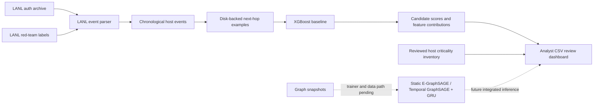

# Current project architecture

## Implemented data path

- `src/data_processing/lanl_dataset.py` reads comma-separated auth and
  red-team files, aligns red-team records to auth events, and can write
  non-overlapping time windows. An optional flow reader is available.
- `src/data_processing/streaming_examples.py` reads the compressed archives
  directly. It scores red-team candidate edges from prior-window aggregates,
  maintains historical host/pair state in a persistent SQLite checkpoint, and
  samples negative destination hosts.
- `scripts/train_xgboost.py` makes chronological train/validation/test splits
  and writes a model bundle and metrics.
- `scripts/predict_next_hops.py` scores candidates in batches and exports
  local feature contributions.
- `app/risk_dashboard.py` combines those CSV predictions with an explicit
  asset inventory and source-host filter.

## Planned model path

`src/models/static_e_graphsage.py` and
`src/models/temporal_attack_model.py` contain reusable pair scorers. The
repository does not yet construct the graph snapshots, train these models, or
integrate them into the dashboard. Their presence is not evidence of a trained
or evaluated GNN.

The former generic upload, forecast, simulation, and production-monitoring
application has been removed from the active source tree. The current
Streamlit dashboard is a CSV review prototype. The synopsis-proposed FastAPI
service and React/Cytoscape interface still need to be implemented and
connected to model inference.
