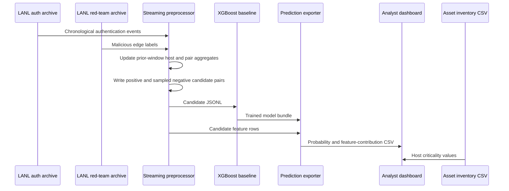

# Data flow for next-hop prediction

## Feature/label separation

For each prediction window, feature aggregates come from events in earlier
windows. Red-team edges in the prediction window supply positive labels. The
source host must have appeared in earlier red-team activity to enter the
current candidate set. Negative destinations are sampled from hosts already
observed in the event stream.

The graph-model flow is incomplete: graph snapshots and a training pipeline
are still required. The example builder saves output offsets and aggregate
state together after each completed window. On resume it truncates uncommitted
output rows and skips completed windows; compressed input must be reread from
the start to reach that checkpoint.
