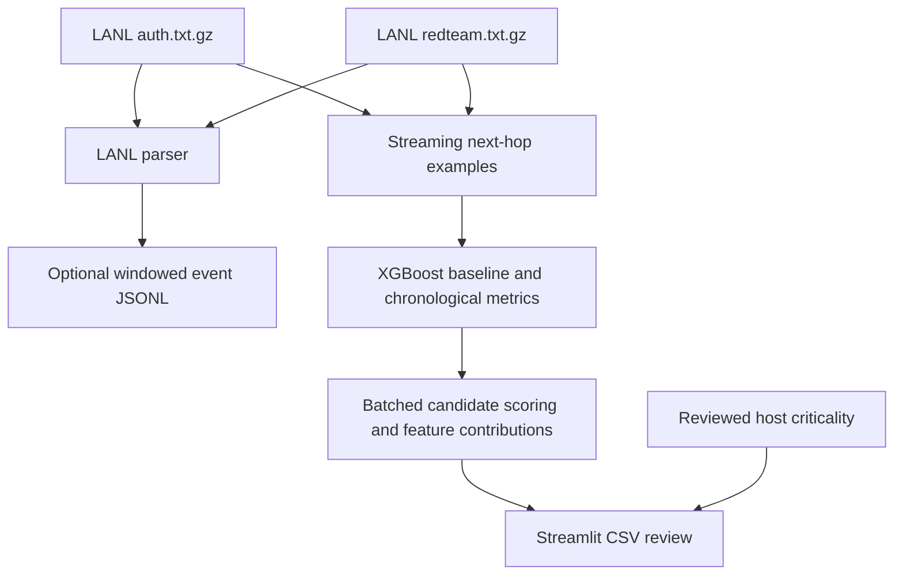
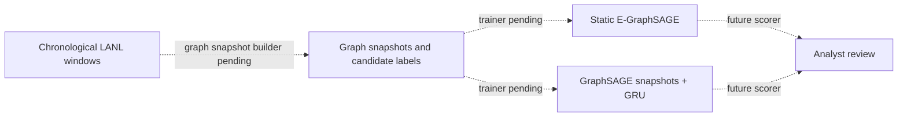

# Synopsis system architecture

## Current baseline path

The streaming example builder does not require the complete windowed-event
intermediate. It maintains cumulative host and pair statistics in a persistent
SQLite checkpoint and writes candidate examples to JSONL. Completed windows
and output offsets are saved together so an interrupted run can resume safely.

## Planned graph-model path

The static and temporal model files currently define scorers only. They are not
trained checkpoints, and the models are not connected to the dashboard.

## Boundaries

- LANL red-team labels are used for supervised attack-edge targets; they do
  not indicate business criticality.
- The review app reads predictions and inventory from CSV files.
- Automated containment, a production REST API, streaming ingestion, and
  measured service-level objectives are outside the implemented project path.
