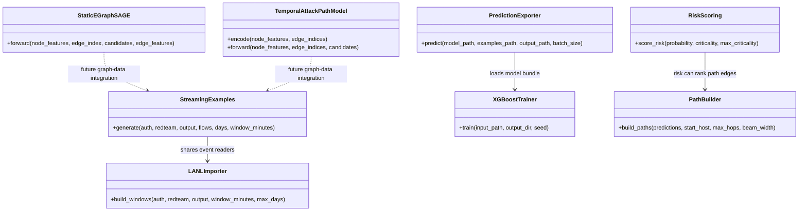

# Current model and inference components

The diagram lists implemented components only. It does not imply that the GNN
models have been trained or integrated.

Source files are listed in [the system architecture](SYSTEM_ARCHITECTURE.md)
and [synopsis alignment](../../docs/PROJECT_ALIGNMENT.md). The current
dashboard consumes CSV files and is not represented as calling model inference.
