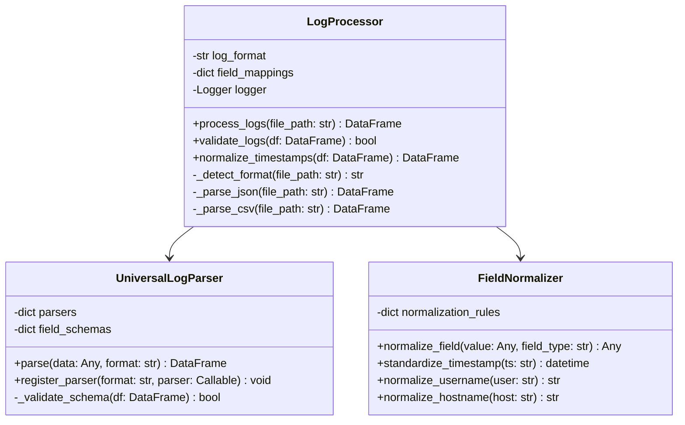
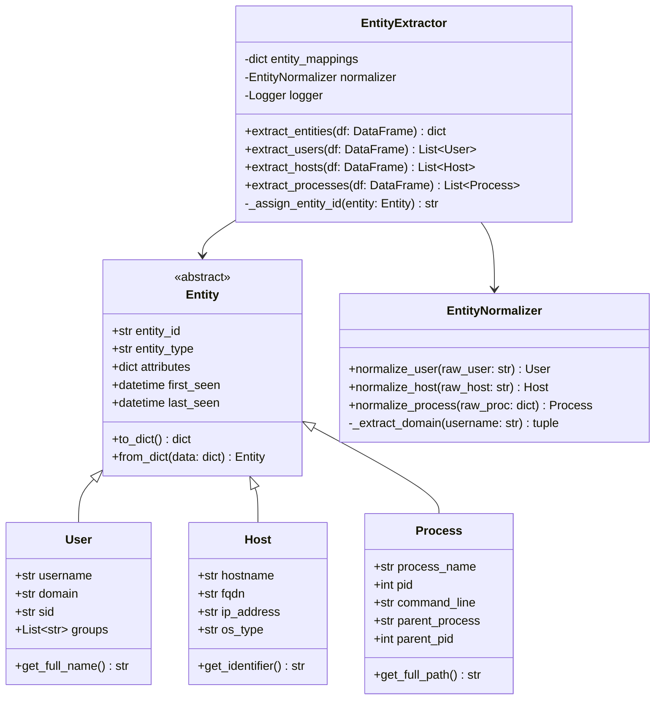
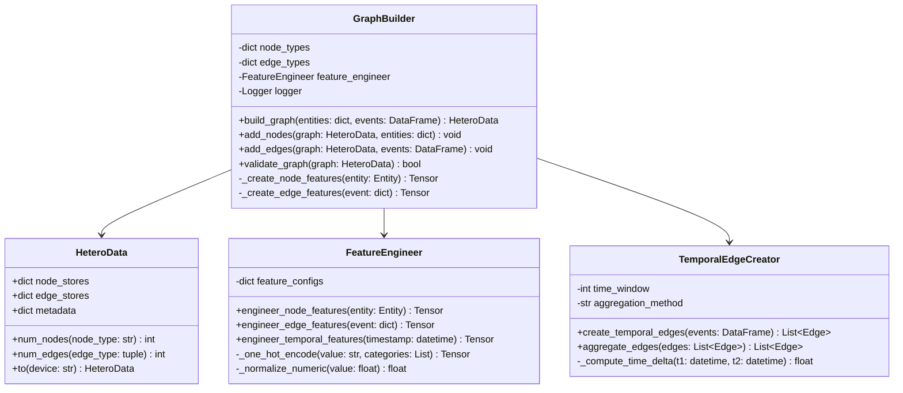
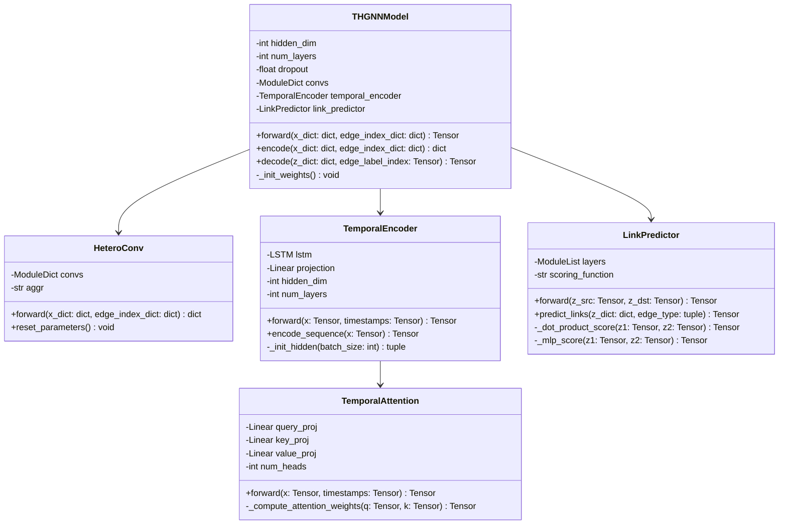
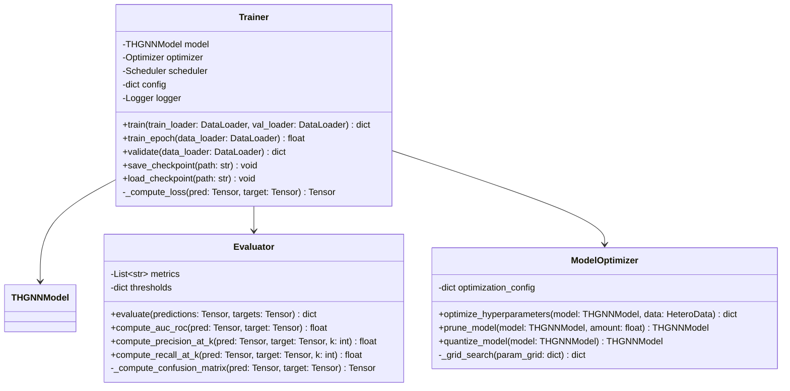
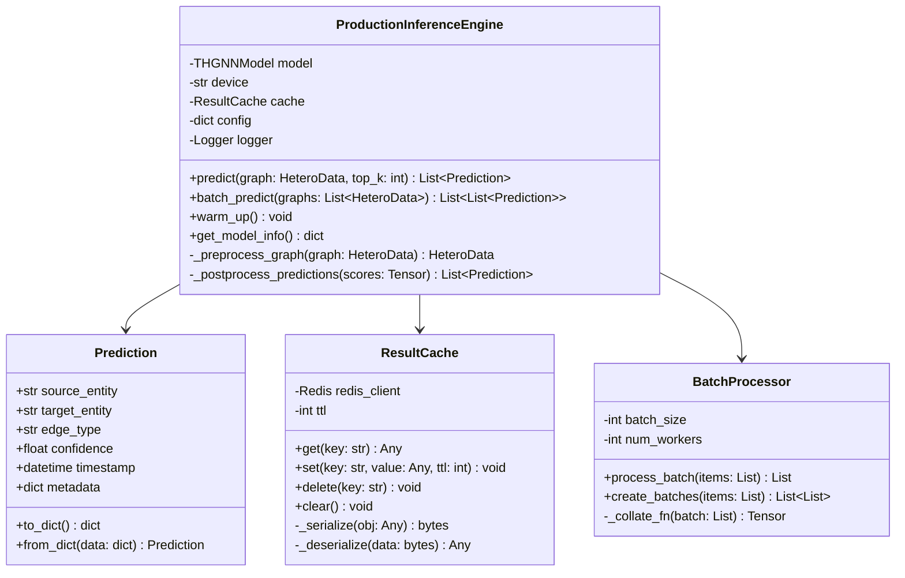
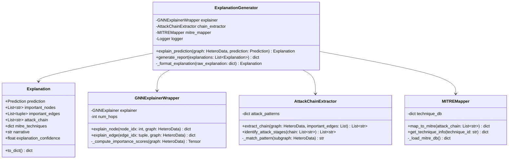
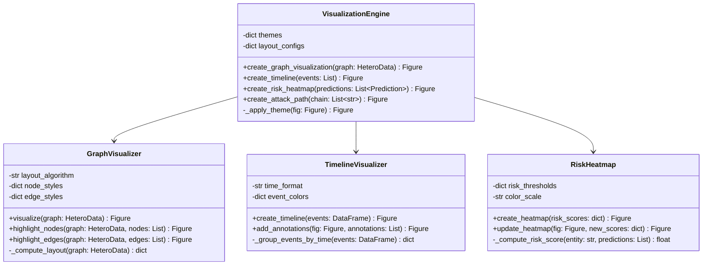
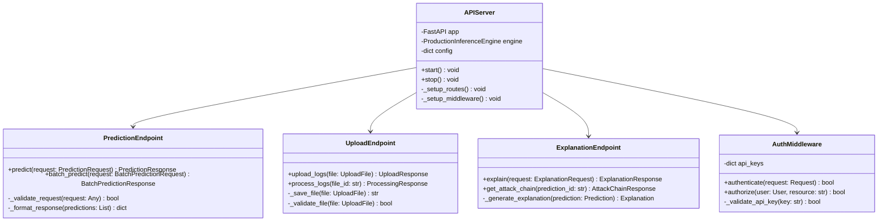
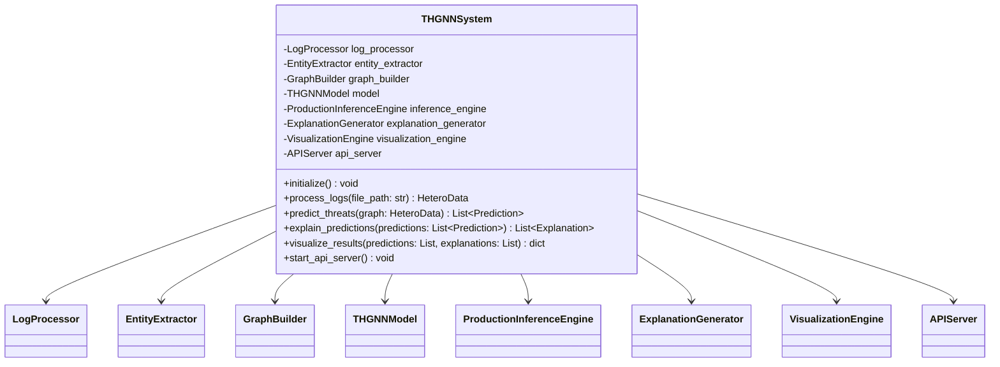

# UML Class Diagrams
## THGNN System Class Structure

**Document Version:** 1.0.0  
**Last Updated:** February 9, 2026

---

## Table of Contents

1. [Data Processing Module](#data-processing-module)
2. [Model Architecture](#model-architecture)
3. [Inference Engine](#inference-engine)
4. [Explainability Module](#explainability-module)
5. [Visualization Components](#visualization-components)
6. [API Layer](#api-layer)

---

## Data Processing Module

### Class Diagram: Log Processing

### Class Diagram: Entity Extraction

### Class Diagram: Graph Construction

---

## Model Architecture

### Class Diagram: THGNN Core

### Class Diagram: Training Components

---

## Inference Engine

### Class Diagram: Production Inference

---

## Explainability Module

### Class Diagram: Explanation Generation

---

## Visualization Components

### Class Diagram: Visualization Engine

---

## API Layer

### Class Diagram: REST API

---

## Complete System Class Hierarchy

---

## Design Patterns Used

### 1. Factory Pattern
- **EntityFactory**: Creates different entity types
- **ParserFactory**: Creates appropriate log parsers
- **VisualizationFactory**: Creates different visualization types

### 2. Strategy Pattern
- **ScoringStrategy**: Different link prediction scoring functions
- **AggregationStrategy**: Different edge aggregation methods
- **LayoutStrategy**: Different graph layout algorithms

### 3. Observer Pattern
- **ModelObserver**: Monitors training progress
- **CacheObserver**: Tracks cache hit/miss rates
- **MetricsObserver**: Collects performance metrics

### 4. Singleton Pattern
- **ConfigManager**: Global configuration access
- **Logger**: Centralized logging
- **CacheManager**: Shared cache instance

### 5. Builder Pattern
- **GraphBuilder**: Constructs complex graph structures
- **ExplanationBuilder**: Builds detailed explanations
- **ReportBuilder**: Generates comprehensive reports

---

**Document Control**

| Version | Date | Author | Changes |
|---------|------|--------|---------|
| 1.0.0 | 2026-02-09 | Development Team | Initial release |
