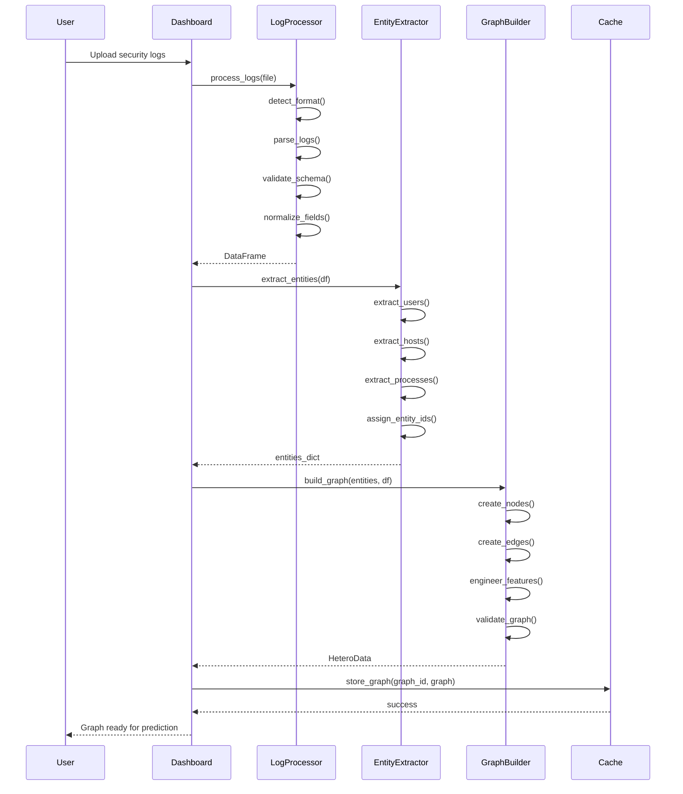
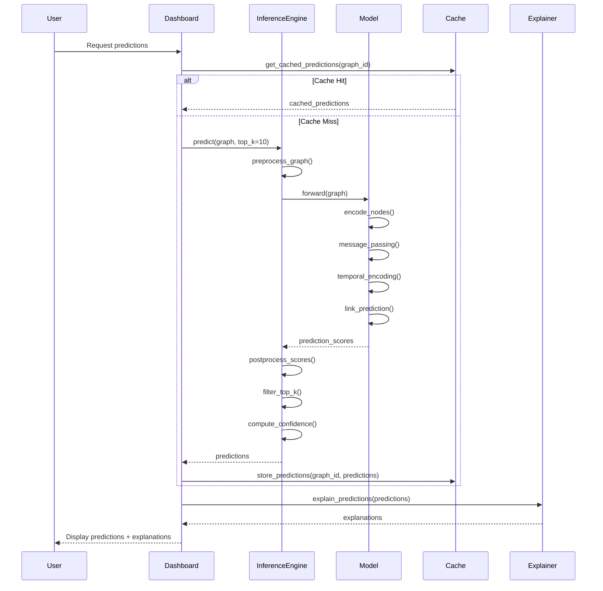
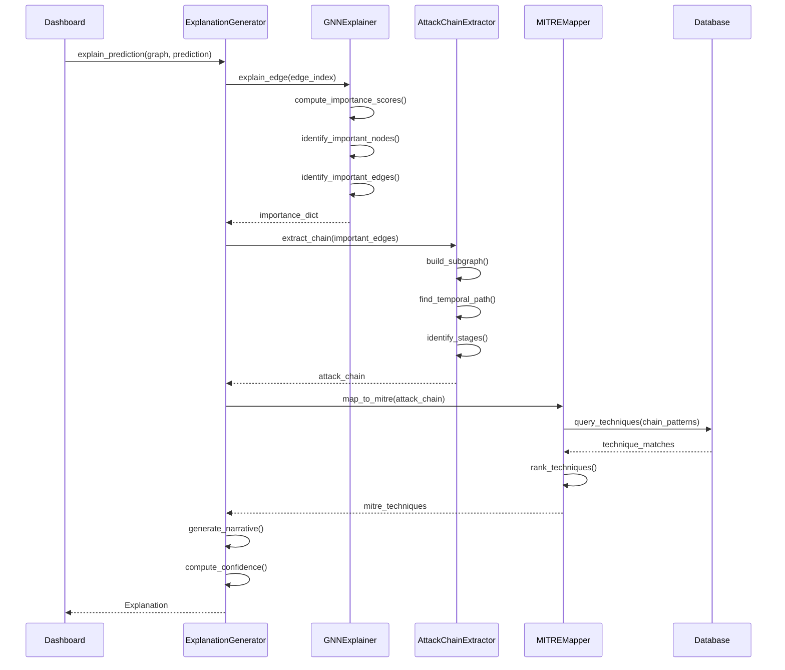
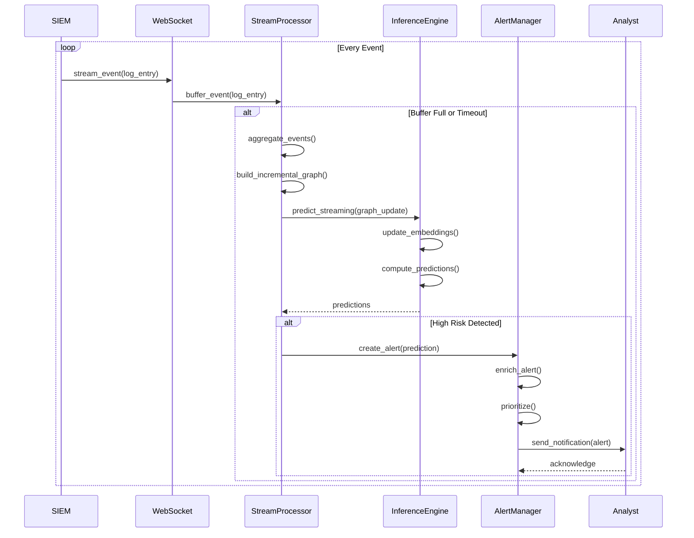
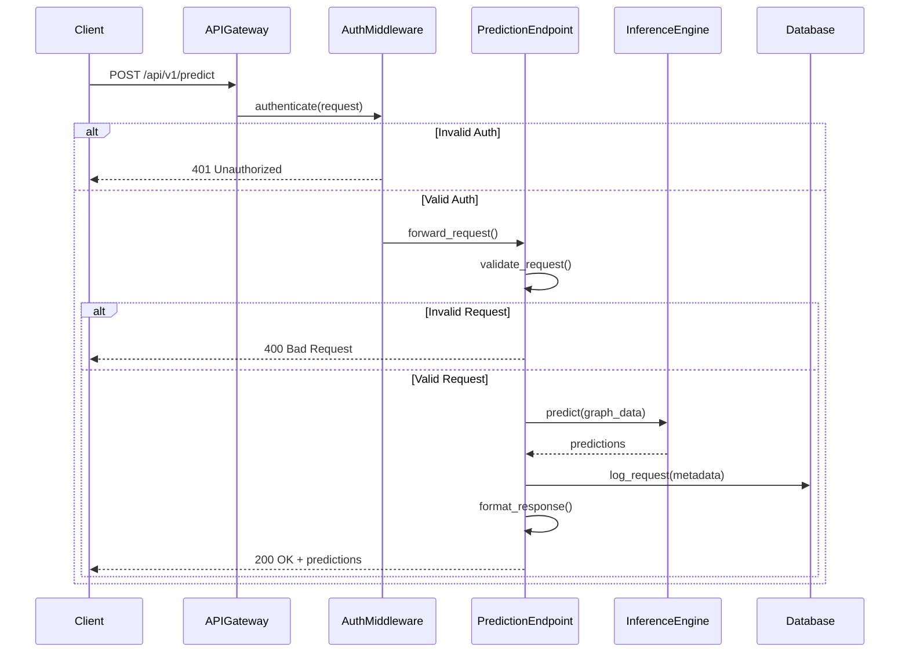
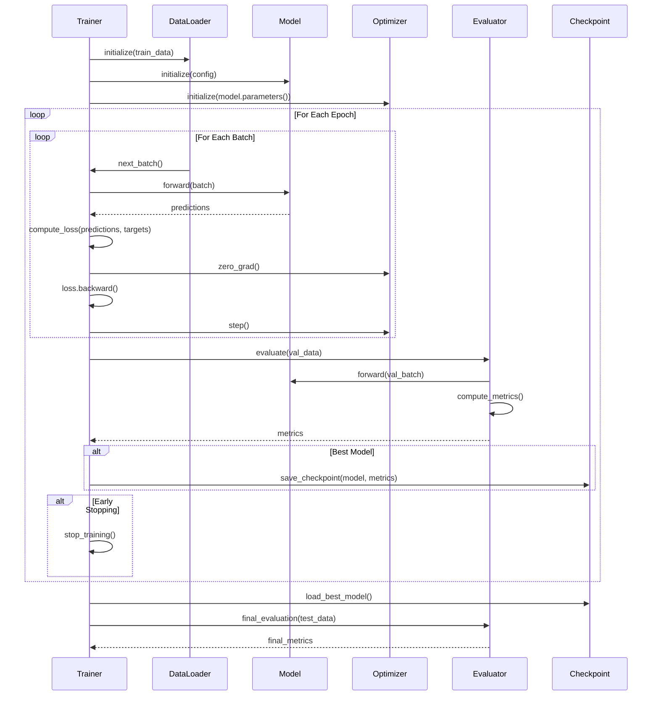
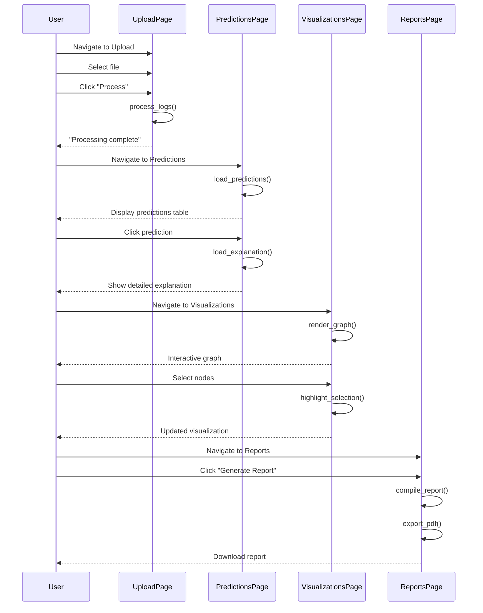
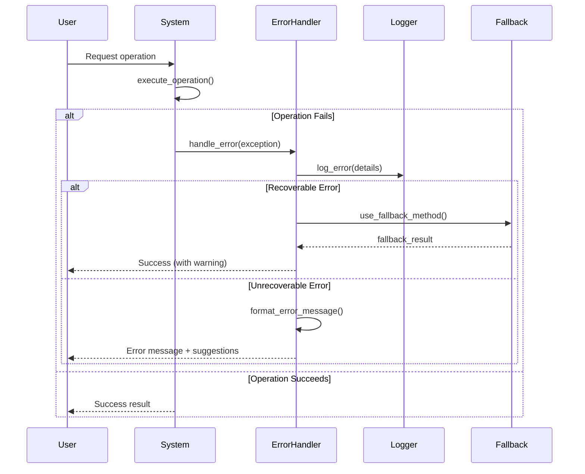
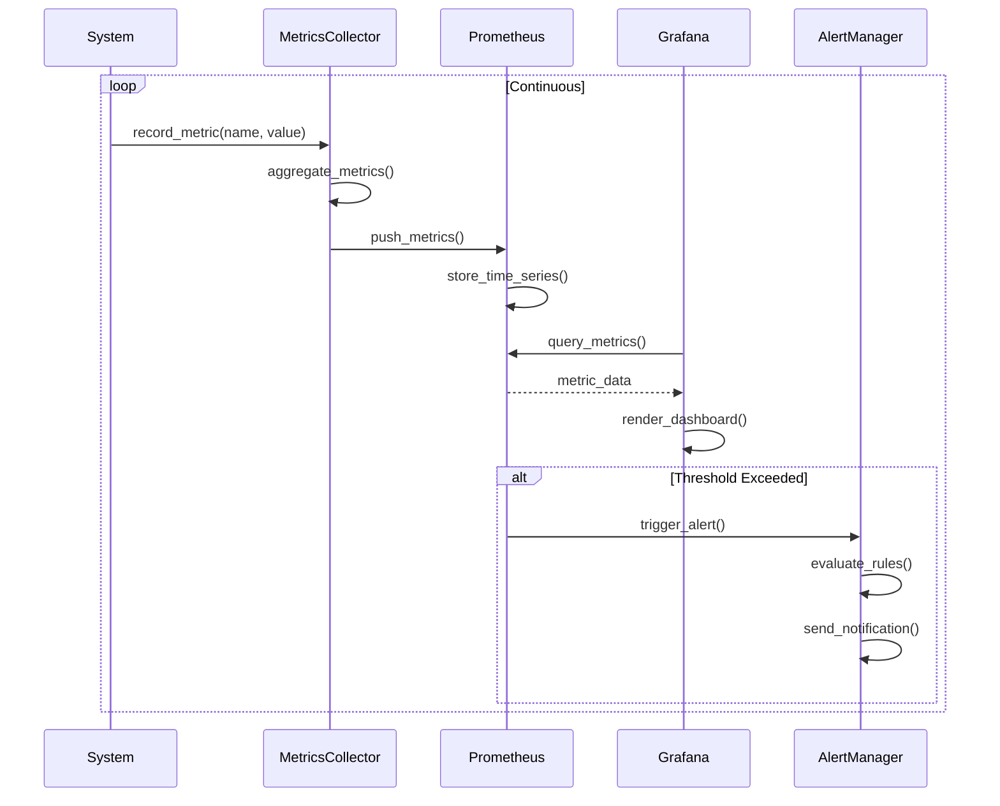

# Sequence Diagrams
## THGNN System Interactions

**Document Version:** 1.0.0  
**Last Updated:** February 9, 2026

---

## Table of Contents

1. [Log Processing Sequence](#log-processing-sequence)
2. [Prediction Flow](#prediction-flow)
3. [Explanation Generation](#explanation-generation)
4. [Real-Time Monitoring](#real-time-monitoring)
5. [API Request Flow](#api-request-flow)
6. [Training Pipeline](#training-pipeline)

---

## Log Processing Sequence

### Complete Log-to-Graph Pipeline

---

## Prediction Flow

### End-to-End Inference Sequence

---

## Explanation Generation

### GNNExplainer Integration

---

## Real-Time Monitoring

### Streaming Prediction Pipeline

---

## API Request Flow

### REST API Prediction Endpoint

---

## Training Pipeline

### Model Training Sequence

---

## User Interaction Flows

### Dashboard Navigation

---

## Error Handling Flows

### Graceful Degradation

---

## Performance Monitoring

### Metrics Collection Flow

---

**Document Control**

| Version | Date | Author | Changes |
|---------|------|--------|---------|
| 1.0.0 | 2026-02-09 | Architecture Team | Initial release |
