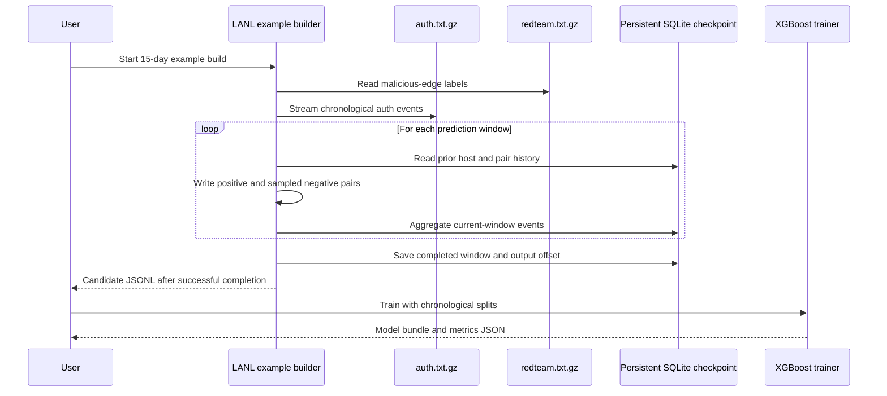
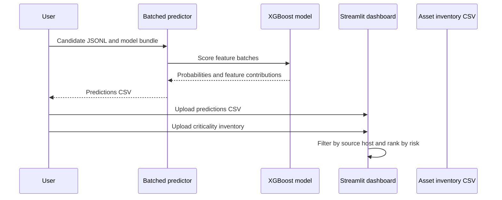

# Current project sequence diagrams

## Build and train the baseline

## Score and review candidates

## Planned graph training sequence

Graph snapshot generation, static/temporal GNN training, and model-backed
dashboard inference are not implemented yet. Add them only after defining the
chronological snapshot and candidate-label format.
