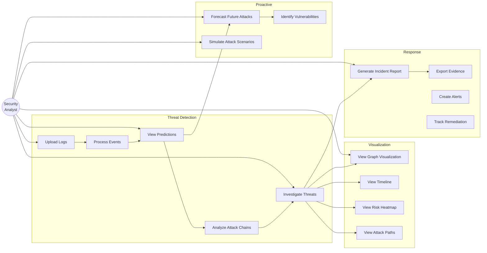
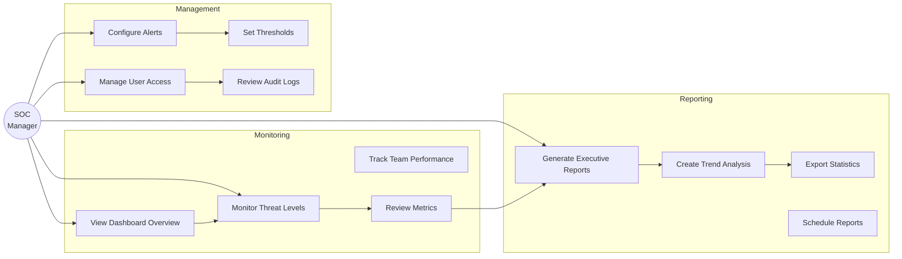
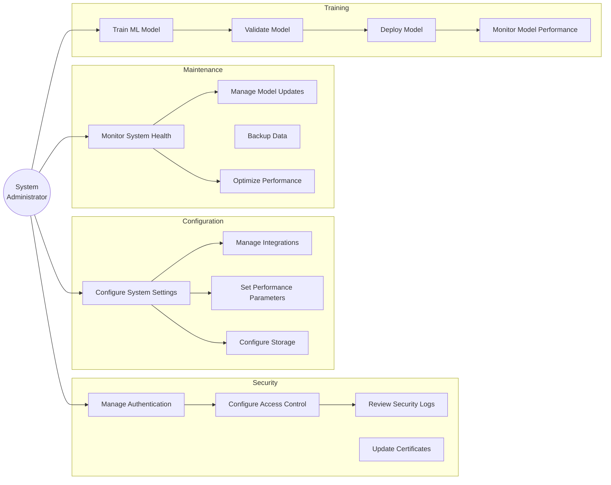
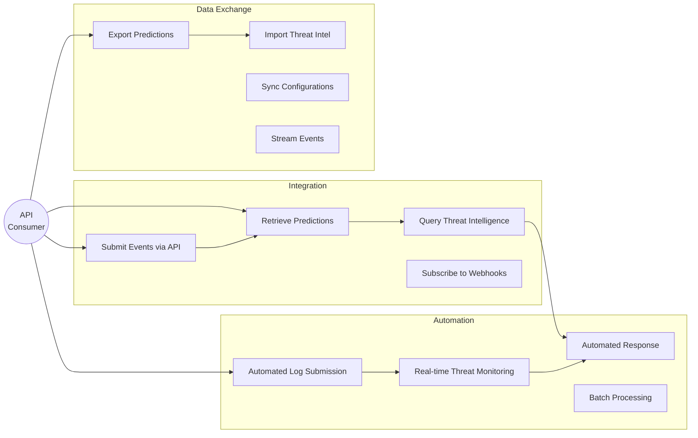
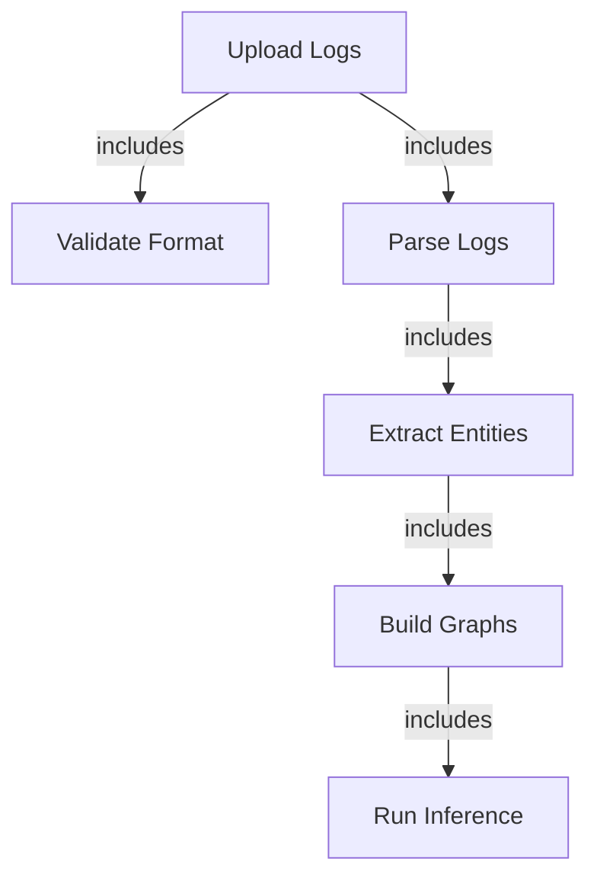
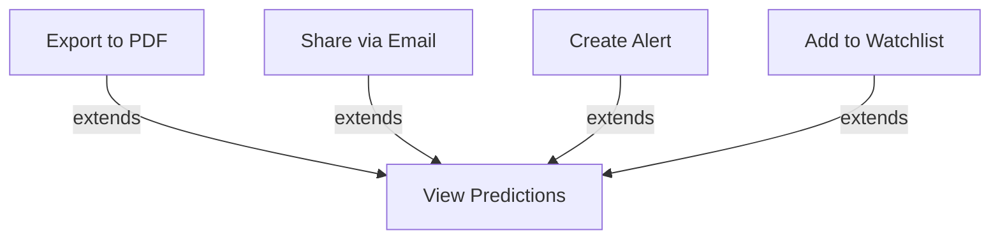
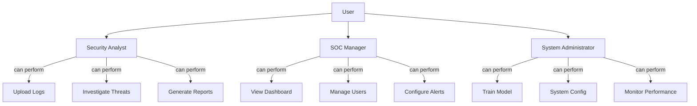
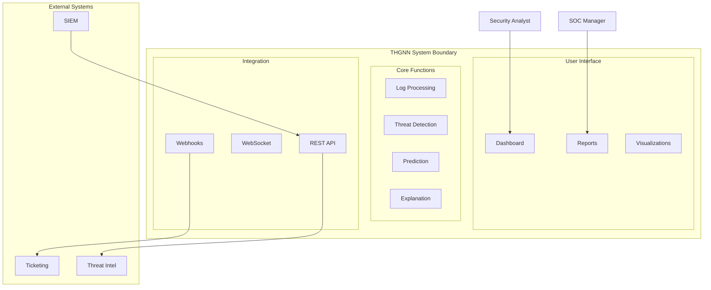

# Use Case Diagrams
## THGNN System User Interactions

**Document Version:** 1.0.0  
**Last Updated:** February 9, 2026  
**Classification:** System Design

---

## Table of Contents

1. [System Overview Use Case](#system-overview-use-case)
2. [Security Analyst Use Cases](#security-analyst-use-cases)
3. [SOC Manager Use Cases](#soc-manager-use-cases)
4. [System Administrator Use Cases](#system-administrator-use-cases)
5. [API Consumer Use Cases](#api-consumer-use-cases)
6. [Detailed Use Case Specifications](#detailed-use-case-specifications)

---

## System Overview Use Case

### Complete System Actors and Use Cases

```mermaid
graph TB
    subgraph "THGNN Threat Detection System"
        UC1[Upload Security Logs]
        UC2[Analyze Threats]
        UC3[View Predictions]
        UC4[Generate Reports]
        UC5[Investigate Alerts]
        UC6[Configure System]
        UC7[Monitor Performance]
        UC8[Train Model]
        UC9[Simulate Attacks]
        UC10[Export Data]
        UC11[Manage Users]
        UC12[API Integration]
    end
    
    Analyst[Security Analyst]
    Manager[SOC Manager]
    Admin[System Administrator]
    SIEM[External SIEM]
    API[API Consumer]
    
    Analyst --> UC1
    Analyst --> UC2
    Analyst --> UC3
    Analyst --> UC5
    Analyst --> UC9
    
    Manager --> UC3
    Manager --> UC4
    Manager --> UC7
    Manager --> UC11
    
    Admin --> UC6
    Admin --> UC7
    Admin --> UC8
    Admin --> UC11
    
    SIEM --> UC1
    SIEM --> UC12
    
    API --> UC12
    API --> UC10
```

---

## Security Analyst Use Cases

### Primary Actor: Security Analyst

### Detailed Analyst Use Cases

#### UC-A1: Upload and Analyze Security Logs

**Actor**: Security Analyst

**Preconditions**:
- Analyst has access to THGNN dashboard
- Security logs are available in supported format

**Main Flow**:
1. Analyst navigates to Upload Logs page
2. Analyst selects log file (JSON, CSV, JSONL, EVTX)
3. System validates file format and size
4. Analyst clicks "Process Logs"
5. System extracts entities from logs
6. System builds temporal heterogeneous graphs
7. System runs ML inference for threat prediction
8. System displays predictions with risk scores
9. Analyst reviews top threats

**Postconditions**:
- Predictions are stored in session
- Visualizations are available
- Alerts are generated for critical threats

**Alternative Flows**:
- 3a. Invalid format → System shows error, requests correct format
- 4a. File too large → System suggests splitting file
- 7a. No threats detected → System shows "All Clear" status

---

#### UC-A2: Investigate Predicted Threat

**Actor**: Security Analyst

**Preconditions**:
- Predictions are available from previous analysis
- Analyst has selected a specific prediction

**Main Flow**:
1. Analyst clicks on high-risk prediction
2. System displays detailed threat information
3. System shows MITRE ATT&CK technique mapping
4. System displays attack chain visualization
5. System shows affected entities (users, hosts, processes)
6. Analyst reviews GNNExplainer explanation
7. System highlights important nodes and edges
8. Analyst examines temporal sequence
9. Analyst decides on response action

**Postconditions**:
- Investigation details are logged
- Analyst has actionable intelligence

**Alternative Flows**:
- 6a. Explanation unclear → Analyst requests additional context
- 9a. False positive → Analyst marks as benign

---

#### UC-A3: Generate Incident Report

**Actor**: Security Analyst

**Preconditions**:
- Threat investigation is complete
- Evidence has been collected

**Main Flow**:
1. Analyst navigates to Reports page
2. Analyst selects predictions to include
3. Analyst chooses report format (PDF, JSON, CSV)
4. System compiles threat details
5. System includes visualizations
6. System adds MITRE ATT&CK mappings
7. System generates executive summary
8. Analyst reviews report
9. Analyst downloads report
10. Analyst shares with stakeholders

**Postconditions**:
- Report is generated and stored
- Incident is documented
- Stakeholders are informed

---

#### UC-A4: Forecast Future Attack Steps

**Actor**: Security Analyst

**Preconditions**:
- Current threat analysis is complete
- Temporal graph sequence is available

**Main Flow**:
1. Analyst navigates to Forecasting page
2. Analyst sets forecast horizon (1-5 steps)
3. Analyst sets confidence threshold
4. System runs multi-step prediction
5. System displays forecasted attack path
6. System shows probability for each step
7. System identifies critical targets
8. Analyst reviews forecast
9. Analyst implements preventive measures

**Postconditions**:
- Future threats are identified
- Preventive actions are planned
- Critical assets are protected

---

#### UC-A5: Simulate Attack Scenario

**Actor**: Security Analyst

**Preconditions**:
- Analyst wants to test detection capabilities
- Simulation scenarios are available

**Main Flow**:
1. Analyst navigates to Attack Simulation page
2. Analyst selects attack scenario (lateral movement, ransomware, etc.)
3. Analyst configures simulation parameters
4. System generates synthetic attack events
5. System processes events through ML pipeline
6. System displays real-time detection results
7. Analyst observes system response
8. System shows detection timeline
9. Analyst evaluates detection effectiveness

**Postconditions**:
- Detection capabilities are validated
- System performance is measured
- Gaps are identified

---

## SOC Manager Use Cases

### Primary Actor: SOC Manager

### Detailed Manager Use Cases

#### UC-M1: Monitor Overall Threat Landscape

**Actor**: SOC Manager

**Preconditions**:
- Manager has dashboard access
- System is processing security events

**Main Flow**:
1. Manager logs into dashboard
2. System displays threat overview
3. Manager views current threat level
4. Manager reviews risk distribution
5. Manager checks critical alerts count
6. Manager examines trend charts
7. Manager identifies patterns
8. Manager allocates resources accordingly

**Postconditions**:
- Threat landscape is understood
- Resources are optimally allocated

---

#### UC-M2: Generate Executive Report

**Actor**: SOC Manager

**Preconditions**:
- Reporting period data is available
- Manager has report generation permissions

**Main Flow**:
1. Manager navigates to Reports section
2. Manager selects reporting period
3. Manager chooses metrics to include
4. System aggregates threat data
5. System calculates KPIs
6. System generates visualizations
7. System creates executive summary
8. Manager reviews report
9. Manager exports to PDF
10. Manager presents to leadership

**Postconditions**:
- Executive report is generated
- Leadership is informed
- Strategic decisions are supported

---

## System Administrator Use Cases

### Primary Actor: System Administrator

### Detailed Administrator Use Cases

#### UC-AD1: Train New ML Model

**Actor**: System Administrator

**Preconditions**:
- Training data is prepared
- GPU resources are available
- Admin has training permissions

**Main Flow**:
1. Admin navigates to Model Training section
2. Admin selects training dataset
3. Admin configures hyperparameters
4. Admin sets training epochs
5. System validates data quality
6. System initiates training process
7. System displays training progress
8. System shows validation metrics
9. Admin monitors AUC-ROC score
10. System saves best model checkpoint
11. Admin validates model performance
12. Admin deploys model to production

**Postconditions**:
- New model is trained
- Model achieves target metrics
- Model is deployed

**Alternative Flows**:
- 9a. Poor performance → Admin adjusts hyperparameters, retrain
- 11a. Validation fails → Admin reviews data quality

---

#### UC-AD2: Monitor System Performance

**Actor**: System Administrator

**Preconditions**:
- System is operational
- Monitoring tools are configured

**Main Flow**:
1. Admin accesses monitoring dashboard
2. System displays CPU/GPU utilization
3. System shows memory usage
4. System displays prediction latency
5. System shows throughput metrics
6. Admin reviews error rates
7. Admin checks cache hit rates
8. Admin examines queue depths
9. Admin identifies bottlenecks
10. Admin optimizes configuration

**Postconditions**:
- System performance is optimal
- Issues are identified and resolved

---

## API Consumer Use Cases

### Primary Actor: External System (SIEM, Automation Platform)

### Detailed API Use Cases

#### UC-API1: Submit Security Events via REST API

**Actor**: External SIEM System

**Preconditions**:
- API authentication is configured
- Events are formatted correctly

**Main Flow**:
1. SIEM collects security events
2. SIEM formats events as JSON
3. SIEM authenticates with API key
4. SIEM sends POST request to /api/v1/events
5. System validates request format
6. System processes events through pipeline
7. System returns processing status
8. SIEM receives prediction results
9. SIEM stores results in database

**Postconditions**:
- Events are processed
- Predictions are available
- SIEM is updated

**Alternative Flows**:
- 5a. Invalid format → System returns 400 error with details
- 6a. Processing fails → System returns 500 error, SIEM retries

---

#### UC-API2: Real-time Threat Monitoring via WebSocket

**Actor**: Security Automation Platform

**Preconditions**:
- WebSocket connection is established
- Platform has valid credentials

**Main Flow**:
1. Platform connects to WebSocket endpoint
2. System authenticates connection
3. Platform subscribes to threat events
4. System processes security logs continuously
5. System detects high-risk threat
6. System sends real-time alert via WebSocket
7. Platform receives alert
8. Platform triggers automated response
9. Platform acknowledges alert

**Postconditions**:
- Real-time monitoring is active
- Threats are detected immediately
- Automated responses are triggered

---

## Detailed Use Case Specifications

### Use Case Template

Each use case follows this structure:

| Field | Description |
|-------|-------------|
| **UC-ID** | Unique identifier |
| **Name** | Use case name |
| **Actor** | Primary actor |
| **Preconditions** | Required state before execution |
| **Main Flow** | Step-by-step normal flow |
| **Postconditions** | System state after execution |
| **Alternative Flows** | Exception handling |
| **Business Rules** | Constraints and rules |
| **Non-functional Requirements** | Performance, security requirements |

---

### UC-001: Upload and Process Security Logs

| Field | Value |
|-------|-------|
| **UC-ID** | UC-001 |
| **Name** | Upload and Process Security Logs |
| **Actor** | Security Analyst |
| **Priority** | High |
| **Frequency** | Multiple times per day |
| **Preconditions** | - User is authenticated - Log file is available - File size < 100MB |
| **Triggers** | User clicks "Upload Logs" |
| **Main Success Scenario** | 1. User selects log file 2. System validates format 3. System parses logs 4. System extracts entities 5. System builds graphs 6. System runs ML inference 7. System displays predictions |
| **Postconditions** | - Predictions are generated - Results are cached - Visualizations are available |
| **Alternative Flows** | **3a. Invalid Format** - System shows error message - User corrects format **6a. No Threats Found** - System shows "All Clear" - User continues monitoring |
| **Business Rules** | - Only supported formats accepted - Maximum 100MB file size - Minimum 10 events required |
| **Non-functional** | - Processing time < 5 seconds - Support 10,000+ events - 99.9% uptime |

---

### UC-002: Investigate Threat Prediction

| Field | Value |
|-------|-------|
| **UC-ID** | UC-002 |
| **Name** | Investigate Threat Prediction |
| **Actor** | Security Analyst |
| **Priority** | Critical |
| **Frequency** | Multiple times per hour |
| **Preconditions** | - Predictions are available - User has investigation permissions |
| **Triggers** | User clicks on prediction |
| **Main Success Scenario** | 1. User selects prediction 2. System displays threat details 3. System shows MITRE mapping 4. System visualizes attack chain 5. System provides explanation 6. User reviews evidence 7. User decides action |
| **Postconditions** | - Investigation is logged - Action is recorded - Metrics are updated |
| **Alternative Flows** | **5a. Explanation Unclear** - User requests more details - System provides additional context **7a. False Positive** - User marks as benign - System learns from feedback |
| **Business Rules** | - All investigations are audited - Critical threats require immediate action - Explanations must be human-readable |
| **Non-functional** | - Explanation generation < 1 second - Visualization renders < 2 seconds - Support concurrent investigations |

---

### UC-003: Generate Incident Report

| Field | Value |
|-------|-------|
| **UC-ID** | UC-003 |
| **Name** | Generate Incident Report |
| **Actor** | Security Analyst, SOC Manager |
| **Priority** | High |
| **Frequency** | Daily, Weekly, Monthly |
| **Preconditions** | - Threat data is available - User has report permissions |
| **Triggers** | User clicks "Generate Report" |
| **Main Success Scenario** | 1. User selects report type 2. User chooses time period 3. User selects metrics 4. System aggregates data 5. System generates visualizations 6. System creates summary 7. System exports to PDF 8. User downloads report |
| **Postconditions** | - Report is generated - Report is stored - Audit log is updated |
| **Alternative Flows** | **4a. Insufficient Data** - System notifies user - User adjusts parameters **7a. Export Fails** - System retries - User notified of issue |
| **Business Rules** | - Reports include all required sections - Executive summary is mandatory - MITRE ATT&CK mapping included |
| **Non-functional** | - Report generation < 10 seconds - Support PDF, JSON, CSV formats - Reports are encrypted |

---

## Use Case Relationships

### Include Relationships

### Extend Relationships

---

## Actor Hierarchy

---

## System Boundary

---

## Use Case Priority Matrix

| Use Case | Priority | Frequency | Complexity | Risk |
|----------|----------|-----------|------------|------|
| Upload Logs | Critical | High | Medium | Low |
| Analyze Threats | Critical | High | High | Medium |
| View Predictions | Critical | High | Low | Low |
| Investigate Alerts | High | Medium | Medium | Medium |
| Generate Reports | High | Medium | Low | Low |
| Forecast Attacks | Medium | Low | High | High |
| Simulate Attacks | Low | Low | Medium | Low |
| Train Model | High | Low | High | High |
| Monitor Performance | Medium | High | Low | Low |
| Manage Users | Medium | Low | Low | Low |

---

## Success Metrics

### Use Case Performance Metrics

| Use Case | Target Time | Success Rate | User Satisfaction |
|----------|-------------|--------------|-------------------|
| Upload & Process | < 5 sec | 99% | 4.5/5 |
| Threat Investigation | < 10 sec | 95% | 4.7/5 |
| Report Generation | < 15 sec | 98% | 4.6/5 |
| Forecasting | < 30 sec | 90% | 4.3/5 |
| API Integration | < 2 sec | 99.9% | 4.8/5 |

---

**Document Control**

| Version | Date | Author | Changes |
|---------|------|--------|---------|
| 1.0.0 | 2026-02-09 | Architecture Team | Initial release |

**Next Review**: May 9, 2026
