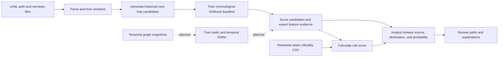

# Synopsis project use cases

The workflow below separates implemented steps from planned graph-model work.

## Data engineer

1. Place `auth.txt.gz` and `redteam.txt.gz` under `data/`.
2. Run the LANL parser or stream the files into next-hop candidate examples.
3. Confirm the generation command completed before training.

## Model developer

1. Train the baseline with chronological train, validation, and test periods.
2. Record positive/negative counts and report metrics from the held-out period.
3. Build graph-snapshot data and trainers before claiming static or temporal
   GNN results.

## Analyst

1. Load candidate predictions and the reviewed `host,criticality` inventory in
   the Streamlit dashboard.
2. Select a source host and inspect target probability, model explanation, and
   risk score.
3. Treat missing criticality as unranked and verify any suggested path against
   the underlying activity.

The current dashboard accepts CSV files; it does not launch model inference or
generate a path from a user-selected host. Those are planned integrations.
